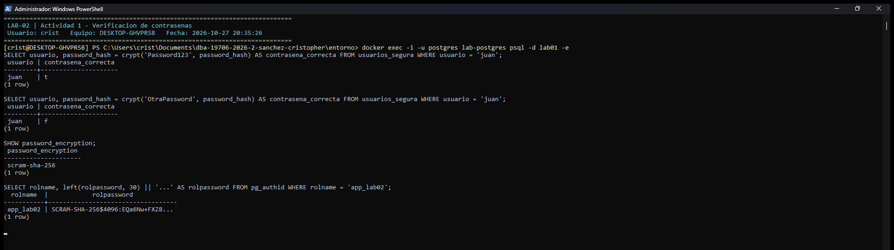

# Evidencia 01 — Protección de credenciales

| | |
|---|---|
| **Estudiante** | Cristopher Enrique Sánchez Castañeda · Matrícula 20434863 · Grupo 403 |
| **Actividad** | 6. Preparación y 7. Actividad 1 — Protección de credenciales |
| **Script** | `sql/01-credenciales.sql` |
| **Entorno** | PostgreSQL 16.15, base de datos `lab01` (la de LAB-01), extensión `pgcrypto` 1.3 |
| **Fecha de ejecución** | 2026-10-27 |

## Objetivo

Demostrar por qué una contraseña no debe guardarse en texto claro y comprobar cómo se protege con un mecanismo de derivación de claves para contraseñas (`crypt()` con bcrypt), que permite **verificar** una contraseña sin poder **recuperarla**.

## Comando o procedimiento

```bash
docker exec -u postgres lab-postgres psql -d lab01 -e \
  -f /unidad-02/lab-02-cifrado-credenciales/sql/01-credenciales.sql
```

1. Se verificó la tabla `clientes` de LAB-01 y la extensión `pgcrypto` (sección 6).
2. Se creó `usuarios_insegura` con la contraseña en texto claro (7.1).
3. Se ejecutó dos veces `crypt('Password123', gen_salt('bf'))` y se comparó con `md5()` (7.3).
4. Se creó `usuarios_segura` guardando solo `password_hash`, con dos usuarios que tienen la misma contraseña (7.4).
5. Se verificó una contraseña correcta y una incorrecta (7.5).
6. Complemento: se revisó cómo guarda PostgreSQL las contraseñas de sus propios roles (SCRAM-SHA-256).

## Resultado obtenido

### Preparación (sección 6)

```text
CREATE EXTENSION IF NOT EXISTS pgcrypto;
psql:sql/01-credenciales.sql:18: NOTICE:  extension "pgcrypto" already exists, skipping
CREATE EXTENSION
SELECT extname, extversion FROM pg_extension WHERE extname = 'pgcrypto';
 extname  | extversion 
----------+------------
 pgcrypto | 1.3
(1 row)

DROP TABLE IF EXISTS usuarios_insegura;
DROP TABLE
DROP TABLE IF EXISTS usuarios_segura;
DROP TABLE
```

### 7.1 Tabla insegura

```text
CREATE TABLE usuarios_insegura (
  id       BIGSERIAL PRIMARY KEY,
  usuario  VARCHAR(50)  NOT NULL,
  password VARCHAR(100) NOT NULL
);
CREATE TABLE
INSERT INTO usuarios_insegura (usuario, password)
VALUES ('juan', 'Password123');
INSERT 0 1
SELECT * FROM usuarios_insegura;
 id | usuario |  password   
----+---------+-------------
  1 | juan    | Password123
(1 row)
```

### 7.3 `crypt()` con sal aleatoria

```text
SELECT crypt('Password123', gen_salt('bf')) AS ejecucion_1;
                         ejecucion_1                          
--------------------------------------------------------------
 $2a$06$8NyK3qGvWAjXiQDfsQXhWu5WQqdNHluLfnFowWmXtwR3B6tgJyZ0a
(1 row)

SELECT crypt('Password123', gen_salt('bf')) AS ejecucion_2;
                         ejecucion_2                          
--------------------------------------------------------------
 $2a$06$MjJL1OhvV1ijfizR99hZJuIESgn.SRqA9PTTZYTXGFSEk0MDnnq3S
(1 row)

-- La sal que genera gen_salt(): cambia en cada llamada
SELECT gen_salt('bf') AS sal_1, gen_salt('bf') AS sal_2;
             sal_1             |             sal_2             
-------------------------------+-------------------------------
 $2a$06$qgCeGvS67AmMRpNvJYBVV. | $2a$06$dL9iUwIDG2nH5YJB4GaZPu
(1 row)

-- Comparación: MD5 sin sal produce SIEMPRE el mismo valor (vulnerable a tablas precalculadas)
SELECT md5('Password123') AS md5_1, md5('Password123') AS md5_2,
       md5('Password123') = md5('Password123') AS iguales;
              md5_1               |              md5_2               | iguales 
----------------------------------+----------------------------------+---------
 42f749ade7f9e195bf475f37a44cafcb | 42f749ade7f9e195bf475f37a44cafcb | t
(1 row)

-- Formato del resultado de bcrypt: $2a$<costo>$<sal de 22 caracteres><hash de 31 caracteres>
WITH h AS (SELECT crypt('Password123', gen_salt('bf')) AS v)
SELECT v                    AS hash_completo,
       split_part(v, '$', 2) AS algoritmo,
       split_part(v, '$', 3) AS costo,
       left(split_part(v, '$', 4), 22) AS sal,
       length(v)            AS longitud
FROM h;
                        hash_completo                         | algoritmo | costo |          sal           | longitud 
--------------------------------------------------------------+-----------+-------+------------------------+----------
 $2a$06$FIoz9CdU7spE/zvfpKix0e18EriSJAMGnf2g9lIVuHiiyPeJs9cke | 2a        | 06    | FIoz9CdU7spE/zvfpKix0e |       60
(1 row)

-- Costo de trabajo: bcrypt es lento a propósito (costo 6 = default de gen_salt, costo 12 = 64 veces más trabajo)
Timing is on.
SELECT crypt('Password123', gen_salt('bf', 6))  IS NOT NULL AS bcrypt_costo_6;
 bcrypt_costo_6 
----------------
 t
(1 row)

Time: 4.025 ms
SELECT crypt('Password123', gen_salt('bf', 12)) IS NOT NULL AS bcrypt_costo_12;
 bcrypt_costo_12 
-----------------
 t
(1 row)

Time: 244.713 ms
SELECT md5('Password123') IS NOT NULL AS md5;
 md5 
-----
 t
(1 row)

Time: 0.350 ms
Timing is off.
```

### 7.4 Tabla segura

```text
CREATE TABLE usuarios_segura (
  id            BIGSERIAL PRIMARY KEY,
  usuario       VARCHAR(50) UNIQUE NOT NULL,
  password_hash TEXT NOT NULL
);
CREATE TABLE
INSERT INTO usuarios_segura (usuario, password_hash)
VALUES ('juan', crypt('Password123', gen_salt('bf')));
INSERT 0 1
INSERT INTO usuarios_segura (usuario, password_hash)
VALUES ('maria', crypt('Password123', gen_salt('bf')));
INSERT 0 1
SELECT * FROM usuarios_segura ORDER BY id;
 id | usuario |                        password_hash                         
----+---------+--------------------------------------------------------------
  1 | juan    | $2a$06$8vP4Jf3wWzExnSl.5yb5UOrYCxxiqS5S52DnwjB0lVTTx/GB/mZSa
  2 | maria   | $2a$06$SIV1RhemVfiodYqmqdeMFujigfJwCQOpn.otmhQsBFoVNC0EjAUvi
(2 rows)

-- ¿Se puede saber que juan y maria tienen la misma contraseña viendo la tabla?
SELECT a.usuario, b.usuario, a.password_hash = b.password_hash AS hashes_iguales
FROM usuarios_segura a JOIN usuarios_segura b ON a.usuario = 'juan' AND b.usuario = 'maria';
 usuario | usuario | hashes_iguales 
---------+---------+----------------
 juan    | maria   | f
(1 row)
```

### 7.5 Verificación de contraseñas

```text
SELECT usuario, password_hash = crypt('Password123', password_hash) AS contraseña_correcta
FROM usuarios_segura WHERE usuario = 'juan';
 usuario | contraseña_correcta 
---------+---------------------
 juan    | t
(1 row)
```

```text
SELECT usuario, password_hash = crypt('OtraPassword', password_hash) AS contraseña_correcta
FROM usuarios_segura WHERE usuario = 'juan';
 usuario | contraseña_correcta 
---------+---------------------
 juan    | f
(1 row)

-- crypt(contraseña, hash_guardado) reutiliza la sal guardada dentro del hash:
SELECT password_hash                         AS guardado,
       crypt('Password123', password_hash)   AS recalculado_correcta,
       crypt('OtraPassword', password_hash)  AS recalculado_incorrecta
FROM usuarios_segura WHERE usuario = 'juan';
                           guardado                           |                     recalculado_correcta                     |                    recalculado_incorrecta                    
--------------------------------------------------------------+--------------------------------------------------------------+--------------------------------------------------------------
 $2a$06$8vP4Jf3wWzExnSl.5yb5UOrYCxxiqS5S52DnwjB0lVTTx/GB/mZSa | $2a$06$8vP4Jf3wWzExnSl.5yb5UOrYCxxiqS5S52DnwjB0lVTTx/GB/mZSa | $2a$06$8vP4Jf3wWzExnSl.5yb5UORHQeG3zE2uLynUN3jr9uI19e88XaGBq
(1 row)

-- No existe una función para "descifrar" el hash: no hay forma de obtener Password123 desde la tabla.
```

### Complemento: contraseñas de roles en PostgreSQL

```text
SHOW password_encryption;
 password_encryption 
---------------------
 scram-sha-256
(1 row)

SELECT TRUE AS existe_variable 
SELECT EXISTS (SELECT 1 FROM pg_roles WHERE rolname = 'app_lab02') AS existe_rol 
ALTER ROLE
Contraseña de app_lab02 asignada desde LAB02_APP_PASSWORD (no se muestra).
GRANT CONNECT ON DATABASE lab01 TO app_lab02;
GRANT
SELECT rolname,
       left(rolpassword, 40) || '...' AS rolpassword_inicio,
       split_part(rolpassword, '$', 1) AS mecanismo
FROM pg_authid WHERE rolname = 'app_lab02';
  rolname  |             rolpassword_inicio              |   mecanismo   
-----------+---------------------------------------------+---------------
 app_lab02 | SCRAM-SHA-256$4096:dIVWk9oqSxjq9JRATILT0... | SCRAM-SHA-256
(1 row)
```

### Capturas de ejecución

Ejecución en el equipo del estudiante (Windows, usuario `crist`, equipo `DESKTOP-GHVPR5B`) con el entorno Docker de `entorno/`, el 2026-10-27. Las capturas complementan los resultados en texto de arriba.

**Texto claro frente a `crypt()` con sal**


**Verificación de contraseñas y SCRAM-SHA-256**



## Análisis

### 7.1 ¿Qué ocurriría si una persona obtiene acceso de lectura a `usuarios_insegura`?

Obtendría la contraseña inmediatamente, sin ningún esfuerzo: `SELECT * FROM usuarios_insegura` devuelve `Password123`. Con eso podría:

- Entrar a la aplicación como `juan` (suplantación).
- Probar la misma contraseña en el correo, el banco o la red de la empresa. Mucha gente reutiliza contraseñas, así que una sola fuga se vuelve varias.
- Hacerlo sin dejar rastro, porque leer una tabla no "rompe" nada.

Y no hace falta que el atacante sea externo: cualquier DBA, desarrollador, respaldo copiado, réplica o volcado (`pg_dump`) que contenga la tabla expone todas las contraseñas. Una filtración de datos se convierte directamente en una filtración de credenciales.

### 7.3 Preguntas

1. **¿Son iguales?** No. Las dos ejecuciones con `Password123` produjeron valores distintos (ver `ejecucion_1` y `ejecucion_2`).
2. **¿Por qué?** Porque cada llamada a `gen_salt('bf')` genera una **sal aleatoria** distinta (`sal_1` ≠ `sal_2`) y la sal entra en el cálculo. Misma contraseña + sal diferente = resultado diferente. En cambio `md5('Password123')` sin sal da siempre `42f749ade7f9e195bf475f37a44cafcb`: si alguien tiene una tabla precalculada de hashes MD5 de contraseñas comunes, la encuentra al instante.
3. **¿Qué función cumple `gen_salt()`?** Genera la sal aleatoria y define el algoritmo y su costo. El prefijo `$2a$06$` indica bcrypt (`2a`) con costo 6 (2⁶ rondas); los 22 caracteres siguientes son la sal.
4. **¿Qué función cumple `crypt()`?** Aplica el algoritmo de derivación (bcrypt) a la contraseña con esa sal y devuelve un texto que incluye **algoritmo + costo + sal + hash**. Por eso basta guardar ese único valor: para verificar, `crypt()` toma la sal del propio hash guardado.
5. **¿Es cifrado reversible?** No. No existe una función que, dado `$2a$06$...`, devuelva `Password123`. Solo se puede volver a calcular y comparar. Es una función de una vía, no un cifrado.

**Costo de trabajo.** bcrypt es lento a propósito: con costo 6 tardó ≈ 4 ms y con costo 12 ≈ 245 ms, frente a ≈ 0.35 ms de MD5. Para un usuario legítimo que inicia sesión, un cuarto de segundo no importa. Para un atacante que prueba millones de contraseñas, multiplica el tiempo del ataque. Por eso se usa un algoritmo diseñado para contraseñas (bcrypt, scrypt, Argon2id) y no un hash rápido como MD5 o SHA-256.

**7.4.** La tabla `usuarios_segura` ya no contiene la contraseña. Además, `juan` y `maria` tienen la misma contraseña, pero sus hashes son distintos (`hashes_iguales = f`): quien lea la tabla ni siquiera puede saber que comparten contraseña.

### 7.5 Preguntas

1. **Con la contraseña correcta:** `contraseña_correcta = t`.
2. **Con la contraseña incorrecta:** `contraseña_correcta = f`.
3. **¿Por qué no es necesario recuperar la contraseña original?** Porque la verificación consiste en repetir el mismo cálculo: `crypt('Password123', password_hash)` reutiliza la sal guardada y produce exactamente el mismo valor guardado. Con `OtraPassword` la sal es la misma (`$2a$06$` + 22 caracteres iguales), pero el resto cambia. Si coinciden, la contraseña es correcta. El sistema solo necesita saber si coincide, no cuál es.
4. **¿Por qué un hash no debe confundirse con cifrado?** El cifrado está diseñado para ser **reversible** con una clave: lo cifrado se descifra. Un hash para contraseñas es de **una vía**: no hay clave ni función inversa. Si las contraseñas se cifraran, quien obtenga la clave (o la encuentre en un script) recupera **todas** las contraseñas de golpe. Con un hash con sal, el atacante tendría que adivinar cada contraseña por separado, y cada intento cuesta tiempo.

### Complemento: PostgreSQL aplica la misma idea

Con `password_encryption = scram-sha-256`, PostgreSQL no guarda la contraseña de `app_lab02`, sino un verificador `SCRAM-SHA-256$4096:<sal>$...` (4096 iteraciones con sal). Además, la contraseña del rol no está escrita en el script: se lee de la variable de entorno `LAB02_APP_PASSWORD` y se desactiva el eco (`\set ECHO none`) para que no aparezca en la salida ni en esta evidencia.

## Conclusión

Una contraseña es un secreto que el sistema solo necesita **verificar**, nunca leer. Por eso se protege con una función de derivación de claves con sal y costo (bcrypt en este laboratorio; SCRAM-SHA-256 en los roles de PostgreSQL) y no con texto claro, un hash rápido sin sal ni cifrado reversible. La sal evita que contraseñas iguales produzcan hashes iguales y anula las tablas precalculadas; el costo hace caro cada intento de fuerza bruta. En una aplicación real se debe usar la función de contraseñas del framework (Argon2id o bcrypt con un costo actual), no un algoritmo propio.
