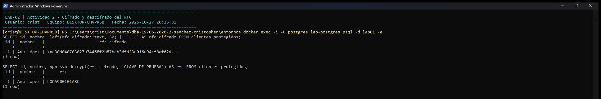
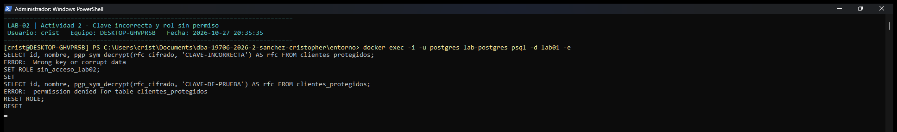

# Evidencia 02 — Cifrado de información sensible

| | |
|---|---|
| **Estudiante** | Cristopher Enrique Sánchez Castañeda · Matrícula 20434863 · Grupo 403 |
| **Actividad** | 8. Actividad 2 — Cifrado de información sensible |
| **Script** | `sql/02-cifrado-datos.sql` (secciones 8.1 a 8.3) |
| **Entorno** | PostgreSQL 16.15, base de datos `lab01`, extensión `pgcrypto` 1.3 |
| **Fecha de ejecución** | 2026-10-27 |

## Objetivo

Proteger el RFC, un dato que **sí** debe poder recuperarse (facturación, trámites fiscales), mediante cifrado simétrico con `pgp_sym_encrypt()`. También comprobar qué pasa con una clave incorrecta y si el cifrado reemplaza o no al control de acceso.

## Comando o procedimiento

```bash
docker exec -u postgres lab-postgres psql -d lab01 -e \
  -f /unidad-02/lab-02-cifrado-credenciales/sql/02-cifrado-datos.sql
```

1. Se creó `clientes_protegidos` con la columna `rfc_cifrado BYTEA` y se insertó el RFC de Ana López cifrado con la clave de laboratorio `CLAVE-DE-PRUEBA` (8.1).
2. Se cifró el mismo RFC dos veces para comparar los resultados.
3. Se descifró con la clave correcta y con una incorrecta (8.2).
4. Se compararon `crypt()` y `pgp_sym_encrypt()` sobre el mismo valor.
5. Se probó el acceso con dos roles: `consulta_lab02` (con `SELECT`) y `sin_acceso_lab02` (sin `SELECT`) (8.3, prueba adicional).

> `CLAVE-DE-PRUEBA` es la clave ficticia que indica el enunciado. No es un secreto real.

## Resultado obtenido

### 8.1 Cifrado

```text
CREATE TABLE clientes_protegidos (
  id          BIGSERIAL PRIMARY KEY,
  nombre      VARCHAR(120) NOT NULL,
  rfc_cifrado BYTEA NOT NULL
);
CREATE TABLE
INSERT INTO clientes_protegidos (nombre, rfc_cifrado)
VALUES ('Ana López', pgp_sym_encrypt('LOPA900101ABC', 'CLAVE-DE-PRUEBA'));
INSERT 0 1
SELECT * FROM clientes_protegidos;
 id |  nombre   |                                                                           rfc_cifrado                                                                            
----+-----------+------------------------------------------------------------------------------------------------------------------------------------------------------------------
  1 | Ana López | \xc30d040703024aa277ce9b2d16e27ad23e019b0f07667c481c86ab9e0fb0d9a835a53e69d66ad44cd154fd20614636c014876f9b8e1b458b4f10bbdf93ec42ccec5354f4826fc2912907de79433eb7
(1 row)

-- Tamaño: el RFC tiene 13 caracteres, el texto cifrado ocupa más (cabecera OpenPGP, sal, vector inicial, integridad)
SELECT length('LOPA900101ABC') AS bytes_rfc, octet_length(rfc_cifrado) AS bytes_cifrado
FROM clientes_protegidos;
 bytes_rfc | bytes_cifrado 
-----------+---------------
        13 |            79
(1 row)

-- El mismo RFC cifrado dos veces con la misma clave produce textos cifrados distintos
SELECT pgp_sym_encrypt('LOPA900101ABC', 'CLAVE-DE-PRUEBA') =
       pgp_sym_encrypt('LOPA900101ABC', 'CLAVE-DE-PRUEBA') AS cifrados_iguales;
 cifrados_iguales 
------------------
 f
(1 row)
```

### 8.2 Descifrado con la clave correcta

```text
SELECT id, nombre, pgp_sym_decrypt(rfc_cifrado, 'CLAVE-DE-PRUEBA') AS rfc
FROM clientes_protegidos;
 id |  nombre   |      rfc      
----+-----------+---------------
  1 | Ana López | LOPA900101ABC
(1 row)
```

### 8.2 Descifrado con una clave incorrecta

```text
SELECT id, nombre, pgp_sym_decrypt(rfc_cifrado, 'CLAVE-INCORRECTA') AS rfc
FROM clientes_protegidos;
psql:sql/02-cifrado-datos.sql:63: ERROR:  Wrong key or corrupt data
```

### Comparación `crypt()` frente a `pgp_sym_encrypt()`

```text
SELECT 'crypt()'           AS funcion,
       crypt('LOPA900101ABC', gen_salt('bf'))                     AS resultado,
       'no existe función inversa'                                AS como_se_recupera
UNION ALL
SELECT 'pgp_sym_encrypt()',
       encode(pgp_sym_encrypt('LOPA900101ABC', 'CLAVE-DE-PRUEBA'), 'base64'),
       'pgp_sym_decrypt(dato, clave)';
      funcion      |                                  resultado                                   |       como_se_recupera       
-------------------+------------------------------------------------------------------------------+------------------------------
 crypt()           | $2a$06$wNHU9KT2ekL10sfTeNsqoOfwHs4ToOLokXZVRuY4lGgkcqRzeLu02                 | no existe función inversa
 pgp_sym_encrypt() | ww0EBwMCYmhMmYkwg7Zk0j4BPpuo38nSBTn6mtHF7ElVoU0Mjz4nFxsh5/Vi3ztyCRBdUPflmucY+| pgp_sym_decrypt(dato, clave)
                   | IGbI3UMurzo6z1PxKF/oWpuR3SZ2FQ==                                             | 
(2 rows)
```

### 8.3 Cifrado y control de acceso

```text
GRANT SELECT ON clientes_protegidos TO consulta_lab02;
GRANT
REVOKE ALL   ON clientes_protegidos FROM sin_acceso_lab02;
REVOKE
SET ROLE consulta_lab02;
SET
-- consulta_lab02 (tiene SELECT) sin la clave: solo ve bytes
SELECT id, nombre, rfc_cifrado FROM clientes_protegidos;
 id |  nombre   |                                                                           rfc_cifrado                                                                            
----+-----------+------------------------------------------------------------------------------------------------------------------------------------------------------------------
  1 | Ana López | \xc30d040703024aa277ce9b2d16e27ad23e019b0f07667c481c86ab9e0fb0d9a835a53e69d66ad44cd154fd20614636c014876f9b8e1b458b4f10bbdf93ec42ccec5354f4826fc2912907de79433eb7
(1 row)

-- consulta_lab02 (tiene SELECT) CON la clave: ve el RFC
SELECT id, nombre, pgp_sym_decrypt(rfc_cifrado, 'CLAVE-DE-PRUEBA') AS rfc FROM clientes_protegidos;
 id |  nombre   |      rfc      
----+-----------+---------------
  1 | Ana López | LOPA900101ABC
(1 row)

RESET ROLE;
RESET
SET ROLE sin_acceso_lab02;
SET
-- sin_acceso_lab02 (sin SELECT) aunque conozca la clave: rechazado
SELECT id, nombre, pgp_sym_decrypt(rfc_cifrado, 'CLAVE-DE-PRUEBA') AS rfc FROM clientes_protegidos;
psql:sql/02-cifrado-datos.sql:90: ERROR:  permission denied for table clientes_protegidos
RESET ROLE;
RESET
```

### Capturas de ejecución

Ejecución en el equipo del estudiante (Windows, usuario `crist`, equipo `DESKTOP-GHVPR5B`) con el entorno Docker de `entorno/`, el 2026-10-27. Las capturas complementan los resultados en texto de arriba.

**Cifrado y descifrado del RFC**



**Clave incorrecta y rol sin permiso**



## Análisis

**Qué se observa.** En la tabla ya no aparece `LOPA900101ABC`, sino 79 bytes binarios. El dato ocupa más que el RFC original (13 bytes) porque el formato OpenPGP agrega cabecera, sal, vector de inicialización y un código de integridad. Los primeros bytes `c3 0d 04 07` son la cabecera: el `07` indica AES-128, el algoritmo por defecto de `pgp_sym_encrypt()`. Además, cifrar dos veces el mismo RFC con la misma clave da resultados distintos (`cifrados_iguales = f`): un observador no puede saber si dos clientes tienen el mismo RFC comparando la columna cifrada.

### 8.2 Preguntas

1. **¿Qué diferencia existe entre `crypt()` y `pgp_sym_encrypt()`?**
   - `crypt()` es una **función de derivación de contraseñas** (hash con sal y costo). Es de una vía: no usa clave y su resultado no se puede revertir. Sirve para **verificar** (¿coincide?).
   - `pgp_sym_encrypt()` es **cifrado simétrico** (AES dentro del formato OpenPGP). Usa una clave y el resultado se puede revertir con esa misma clave. Sirve para **guardar y luego recuperar**.
2. **¿Cuál permite recuperar el dato original?** Solo `pgp_sym_encrypt()`, mediante `pgp_sym_decrypt(dato, clave)`, que devolvió `LOPA900101ABC`. Para `crypt()` no existe función inversa (tabla de comparación).
3. **¿Qué ocurre con una clave incorrecta?** PostgreSQL rechaza la operación: `ERROR: Wrong key or corrupt data`. No devuelve un texto "parecido" ni basura: el formato incluye verificación de integridad, así que el descifrado falla por completo. Si una organización pierde la clave, pierde el dato.
4. **¿Qué problema representa colocar la clave directamente en una consulta?**
   - La clave queda escrita en el script, y el script termina en el repositorio, en copias y en documentación. Quien vea el archivo puede descifrar todos los RFC.
   - La consulta viaja al servidor con la clave dentro: puede aparecer en el registro del servidor (`log_statement`), en `pg_stat_activity` mientras se ejecuta, en el historial de `psql` (`.psql_history`) y en capturas de pantalla.
   - Si la clave está en el mismo servidor o en el mismo respaldo que los datos, cifrar casi no protege: quien obtenga uno obtiene el otro.
   Esto se analiza y se demuestra en la evidencia 03.

### 8.3 Prueba adicional: el cifrado no reemplaza al control de acceso

- `consulta_lab02` tiene `SELECT`: sin la clave solo ve bytes, pero **con** la clave ve el RFC. El cifrado protege contra quien lee la tabla sin conocer la clave (un respaldo robado, un volcado, un usuario curioso), no contra quien tiene acceso **y** clave.
- `sin_acceso_lab02` conoce la clave pero no tiene `SELECT`: `permission denied`. La clave sola no sirve sin acceso al dato.

Son dos barreras distintas: los permisos deciden **quién puede leer la tabla**; la gestión de claves decide **quién puede convertir lo leído en texto claro**. Se necesitan las dos.

## Conclusión

El RFC se protegió con cifrado simétrico porque, a diferencia de una contraseña, la organización **necesita recuperarlo**. `pgp_sym_encrypt()` dejó el dato ilegible para cualquiera que lea la tabla sin la clave, produce resultados distintos en cada cifrado y rechaza claves incorrectas. La seguridad del dato pasa a depender de la clave: si se pierde, el dato es irrecuperable; si se expone, el cifrado ya no protege. Por eso escribir la clave dentro de la consulta, como en el ejemplo del enunciado, sirve para aprender la función, pero no es una práctica aceptable fuera del laboratorio.
