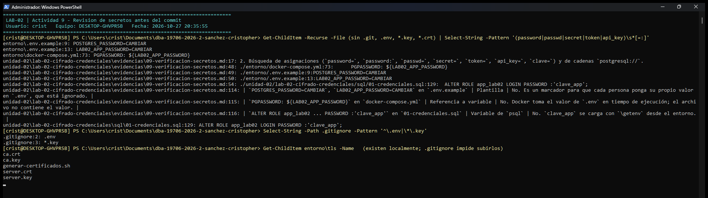

# Evidencia 09 — Verificación de secretos antes de GitLab

| | |
|---|---|
| **Estudiante** | Cristopher Enrique Sánchez Castañeda · Matrícula 20434863 · Grupo 403 |
| **Actividad** | 16. Actividad 9 — Verificación de secretos antes de GitLab |
| **Alcance** | Todo el repositorio (archivos de trabajo **e historial de Git**), justo antes del commit final del laboratorio |
| **Fecha de ejecución** | 2026-10-27 |

## Objetivo

Revisar el repositorio antes del commit final para confirmar que no contiene contraseñas, claves, tokens ni certificados privados reales, y clasificar cada coincidencia de la búsqueda.

## Comando o procedimiento

1. Búsqueda general con el comando del enunciado: `grep -RniE 'password|passwd|secret|token|api_key|clave' .`
2. Búsqueda de asignaciones (`password=`, `password:`, `passwd=`, `secret=`, `token=`, `api_key=`, `clave=`) y de cadenas `postgresql://`.
3. Búsqueda de claves privadas (`BEGIN ... PRIVATE KEY`) y de archivos sensibles versionados (`.env`, `.key`, `.pem`, `.crt`, `pgpass`).
4. Búsqueda de los **valores reales** que se usaron en el entorno (contraseña de `app_lab02` y clave del RFC), sin mostrarlos.
5. La misma revisión sobre **todo el historial** (`git log --all -p`), porque un secreto borrado sigue en los commits anteriores.

## Resultado obtenido

```text
$ grep -RniE "password|passwd|secret|token|api_key|clave" . --exclude-dir=.git | wc -l
324
$ grep -RliE "password|passwd|secret|token|api_key|clave" . --exclude-dir=.git   (archivos con coincidencias)
./.gitignore
./README.md
./entorno/.env.example
./entorno/docker-compose.yml
./entorno/tls/generar-certificados.sh
./unidad-02/lab-02-cifrado-credenciales/README.md
./unidad-02/lab-02-cifrado-credenciales/evidencias/01-credenciales.md
./unidad-02/lab-02-cifrado-credenciales/evidencias/02-cifrado-datos.md
./unidad-02/lab-02-cifrado-credenciales/evidencias/03-gestion-claves.md
./unidad-02/lab-02-cifrado-credenciales/evidencias/04-tls.md
./unidad-02/lab-02-cifrado-credenciales/evidencias/07-comparacion.md
./unidad-02/lab-02-cifrado-credenciales/evidencias/08-analisis-escenario.md
./unidad-02/lab-02-cifrado-credenciales/evidencias/10-politica-claves.md
./unidad-02/lab-02-cifrado-credenciales/sql/01-credenciales.sql
./unidad-02/lab-02-cifrado-credenciales/sql/02-cifrado-datos.sql
./unidad-02/lab-02-cifrado-credenciales/sql/03-verificacion-tls.sql
```

```text
$ grep -RniE "(password|passwd|secret|token|api_key|clave)[[:space:]]*[=:]" . --exclude-dir=.git
./entorno/docker-compose.yml:73:      PGPASSWORD: ${LAB02_APP_PASSWORD}
./entorno/.env.example:9:POSTGRES_PASSWORD=CAMBIAR
./entorno/.env.example:13:LAB02_APP_PASSWORD=CAMBIAR
./unidad-02/lab-02-cifrado-credenciales/sql/02-cifrado-datos.sql:82:\echo '-- consulta_lab02 (tiene SELECT) sin la clave: solo ve bytes'
./unidad-02/lab-02-cifrado-credenciales/sql/02-cifrado-datos.sql:84:\echo '-- consulta_lab02 (tiene SELECT) CON la clave: ve el RFC'
./unidad-02/lab-02-cifrado-credenciales/sql/02-cifrado-datos.sql:89:\echo '-- sin_acceso_lab02 (sin SELECT) aunque conozca la clave: rechazado'
./unidad-02/lab-02-cifrado-credenciales/sql/01-credenciales.sql:129:  ALTER ROLE app_lab02 LOGIN PASSWORD :'clave_app';
./unidad-02/lab-02-cifrado-credenciales/README.md:148:La lección principal es que **cada problema tiene su mecanismo y ninguno sustituye a otro**. Las contraseñas se d...
./unidad-02/lab-02-cifrado-credenciales/evidencias/01-credenciales.md:254:4. **¿Por qué un hash no debe confundirse con cifrado?** El cifrado está diseñado para ser **...
./unidad-02/lab-02-cifrado-credenciales/evidencias/02-cifrado-datos.md:113:-- consulta_lab02 (tiene SELECT) sin la clave: solo ve bytes
./unidad-02/lab-02-cifrado-credenciales/evidencias/02-cifrado-datos.md:120:-- consulta_lab02 (tiene SELECT) CON la clave: ve el RFC
./unidad-02/lab-02-cifrado-credenciales/evidencias/02-cifrado-datos.md:131:-- sin_acceso_lab02 (sin SELECT) aunque conozca la clave: rechazado
./unidad-02/lab-02-cifrado-credenciales/evidencias/02-cifrado-datos.md:164:El RFC se protegió con cifrado simétrico porque, a diferencia de una contraseña, la organiza...
./unidad-02/lab-02-cifrado-credenciales/evidencias/03-gestion-claves.md:111:- **La respuesta correcta es rotar la clave:** generar una nueva, volver a cifrar todos los...
```

```text
$ grep -Rn "postgresql://" . --exclude-dir=.git
(sin resultados)
```

```text
$ grep -RlE "BEGIN .*PRIVATE KEY" . --exclude-dir=.git
./entorno/tls/ca.key
./entorno/tls/server.key
$ git ls-files | grep -E "\.env$|\.key$|\.pem$|\.crt$|pgpass"
(sin resultados: ninguno está versionado)
$ git status --short --ignored   (archivos que existen localmente pero Git ignora)
!! entorno/tls/ca.crt
!! entorno/tls/ca.key
!! entorno/tls/server.crt
!! entorno/tls/server.key
```

```text
$ grep -rcF "<valor real de LAB02_APP_PASSWORD>" . --exclude-dir=.git | grep -v ":0$" | wc -l
0
$ grep -rcF "<valor real de LAB02_CLAVE_RFC>" . --exclude-dir=.git | grep -v ":0$" | wc -l
0
```

```text
$ git log --all -p | grep -cE "BEGIN .*PRIVATE KEY"
0
$ git log --all -p | grep -cF "<valor real de LAB02_APP_PASSWORD>"
0
$ git log --all -p | grep -cF "<valor real de LAB02_CLAVE_RFC>"
0
$ git log --all --oneline -- "*.env" "*.key" "*ejemplo-mala-practica*"
(sin resultados)
```

```text
$ grep -RoE "Password123|OtraPassword|CLAVE-DE-PRUEBA|CLAVE-INCORRECTA" . --exclude-dir=.git | cut -d: -f2 | sort | uniq -c
     29 CLAVE-DE-PRUEBA
      3 CLAVE-INCORRECTA
      5 OtraPassword
     49 Password123
```

### Capturas de ejecución

Ejecución en el equipo del estudiante (Windows, usuario `crist`, equipo `DESKTOP-GHVPR5B`) con el entorno Docker de `entorno/`, el 2026-10-27. Las capturas complementan los resultados en texto de arriba.

**Revisión de secretos en el equipo del estudiante**



## Análisis

**La búsqueda general da 324 coincidencias, y eso es esperado.** Este laboratorio trata justamente de contraseñas y claves, así que las palabras aparecen en explicaciones, nombres de variables y funciones. Por eso el enunciado aclara que el comando no basta por sí solo: hay que **revisar** cada tipo de coincidencia. La clasificación quedó así:

| Coincidencia | Tipo | ¿Es un secreto real? |
|---|---|---|
| `POSTGRES_PASSWORD=CAMBIAR`, `LAB02_APP_PASSWORD=CAMBIAR` en `.env.example` | Plantilla | No. Es un marcador para que cada persona ponga su propio valor en `.env`, que está ignorado. |
| `PGPASSWORD: ${LAB02_APP_PASSWORD}` en `docker-compose.yml` | Referencia a variable | No. Docker toma el valor de `.env` en tiempo de ejecución; el archivo no contiene el valor. |
| `ALTER ROLE app_lab02 ... PASSWORD :'clave_app'` en `01-credenciales.sql` | Variable de `psql` | No. `clave_app` se carga con `\getenv` desde el entorno. |
| `Password123`, `OtraPassword` | Valores ficticios del enunciado | No. Son los datos de ejemplo que pide la Actividad 1. |
| `CLAVE-DE-PRUEBA`, `CLAVE-INCORRECTA` | Claves ficticias del enunciado | No. El enunciado ordena usarlas en la Actividad 2 y la regla 9.2 permite valores ficticios. No protegen datos reales. |
| Las palabras "clave", "contraseña", "password" en textos | Prosa / documentación | No. |
| `entorno/tls/ca.key`, `entorno/tls/server.key` | **Claves privadas reales** del entorno local | **Sí**, pero **no están en el repositorio**: `.gitignore` las excluye, `git ls-files` no las lista y ningún commit las contiene. |

**Lo determinante es la verificación de valores reales.** La contraseña de `app_lab02` y la clave del RFC que se usaron al ejecutar los scripts no aparecen en ningún archivo (V5) ni en ningún commit del historial (V6). Tampoco hay ninguna clave privada en el historial, ni cadenas de conexión `postgresql://` con credenciales. El archivo `ejemplo-mala-practica.sql` nunca se versionó.

**Por qué revisar el historial y no solo los archivos.** Como se demostró en la evidencia 03, un secreto que se agregó y luego se borró sigue recuperable con `git show`. Revisar solo la carpeta actual daría una falsa sensación de seguridad.

**Limitaciones.** `grep` encuentra palabras, no secretos: no detectaría una clave guardada en una variable llamada `x`, codificada en base64 o dentro de un archivo binario. En un equipo real esta revisión se automatiza con un escáner de secretos (por ejemplo, gitleaks o la detección de secretos de GitLab) en un *pre-commit hook* y en CI, además de la revisión manual.

## Conclusión

El repositorio está listo para subirse a GitLab: no contiene secretos reales en los archivos ni en el historial. Las únicas coincidencias son valores ficticios del enunciado, plantillas con `CAMBIAR`, referencias a variables de entorno y texto explicativo. Las claves privadas TLS existen solo en el equipo local y están excluidas por `.gitignore`. El hábito que deja la actividad: revisar antes de cada commit, y revisar también el historial, porque lo que entra a Git se queda.
