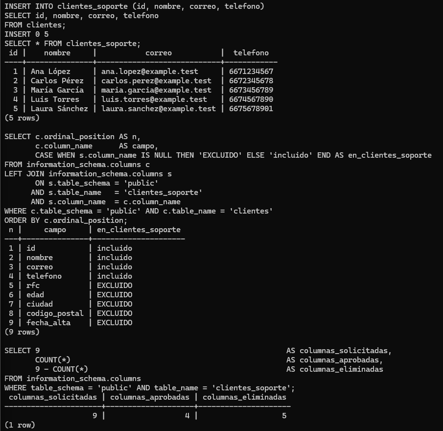
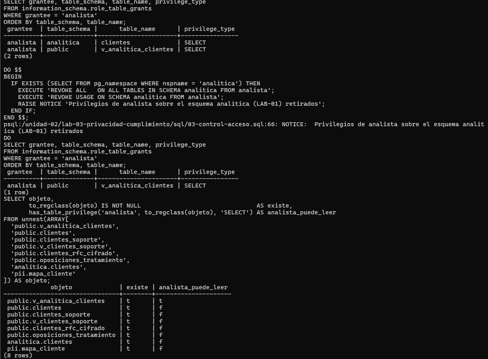
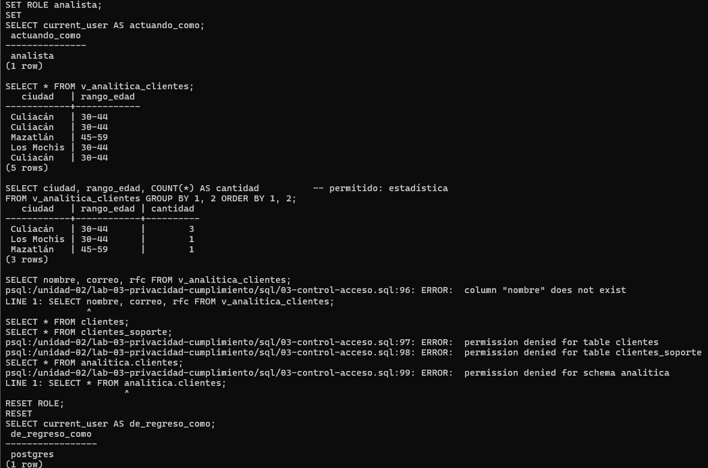
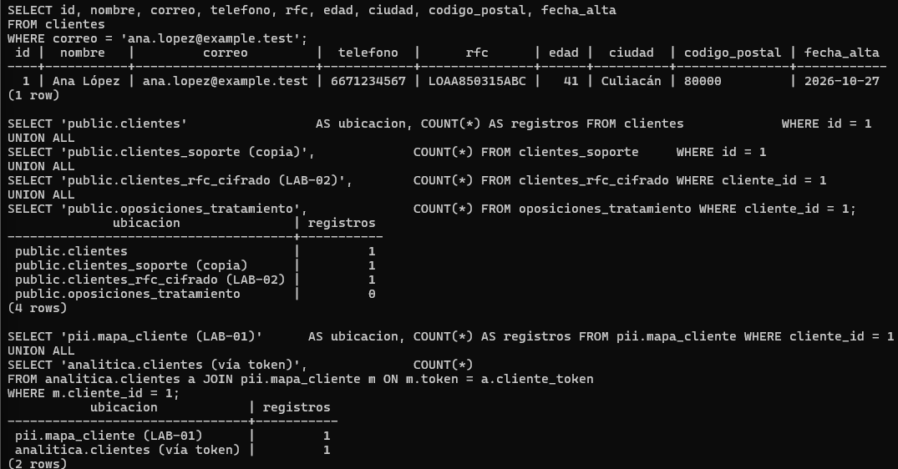
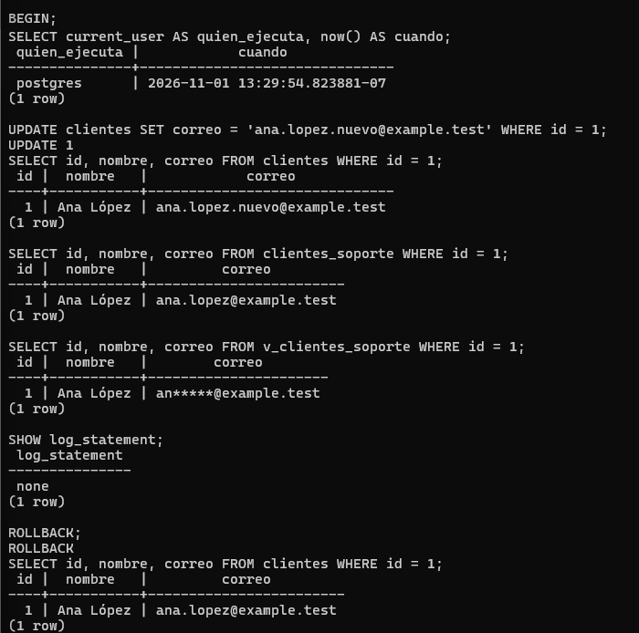

# LAB-03 — Privacidad, cumplimiento y gobierno de los datos

| | |
|---|---|
| Estudiante | Cristopher Enrique Sánchez Castañeda |
| Matrícula | 20434863 |
| Grupo | 403 |
| Materia | Gestión de Seguridad y Desempeño de Bases de Datos |
| Unidad / Tema | II — Seguridad, privacidad y control de acceso / 2.5 Privacidad, cumplimiento y gobierno de los datos |
| Motor | PostgreSQL 16 (16.15) |
| Escenario | Comercializadora Norte S.A. de C.V. (ficticia), base `lab01` con la tabla `clientes` de LAB-01. Los datos son de prueba (`example.test`) y no corresponden a personas reales. |

## Contenido

```
lab-03-privacidad-cumplimiento/
├── README.md                        ← este informe
├── sql/
│   ├── 01-minimizacion.sql          ← Act. 1 (catálogo con COMMENT ON) y Act. 2 (tabla mínima de soporte)
│   ├── 02-finalidad.sql             ← Act. 3 (agregados para analítica) y Act. 9 (oposición por finalidad)
│   └── 03-control-acceso.sql        ← Act. 4 (rol analista y vista), Act. 6 y 7 (acceso y rectificación), Act. 8 (mapa de copias)
└── evidencias/
    ├── 01-inventario-datos.md       ← Actividad 1
    ├── 05-finalidad-secundaria.md   ← Actividad 5
    ├── 08-ciclo-vida.md             ← Actividad 8
    ├── 10-retencion.md              ← Actividad 10
    ├── 11-gobierno-datos.md         ← Actividad 11
    ├── 12-privacidad-diseno.md      ← Actividad 12
    ├── 14-evaluacion-integral.md    ← Actividad 14
    ├── 15-arquitectura.md           ← Actividad 15
    └── capturas/                    ← capturas de la ejecución en el equipo del estudiante (PNG)
```

El enunciado no pide archivo de evidencia para las actividades 2, 3, 4, 6, 7, 9 y 13. Esas se responden aquí, en la sección que les toca.

## Cómo ejecutar

Se necesita el entorno de la raíz del repositorio (`entorno/`) y, dentro del mismo contenedor, los objetos de los laboratorios anteriores: scripts 01, 02 y 03 de LAB-01 y script 02 de LAB-02. El script 03 de este laboratorio los usa para revisar privilegios heredados y para buscar al titular en todas las tablas.

LAB-01 se entregó con su propio contenedor, así que sus scripts 02 y 03 se vuelven a correr en el compartido:

```bash
# Desde la raíz del repositorio, con el contenedor en marcha
# (solo una vez) objetos de LAB-01 en el contenedor compartido
docker exec -u postgres lab-postgres psql -d lab01 -P pager=off -f /unidad-02/lab-01-proteccion-privacidad/sql/02-enmascaramiento.sql
docker exec -u postgres lab-postgres psql -d lab01 -P pager=off -f /unidad-02/lab-01-proteccion-privacidad/sql/03-seudonimizacion.sql

# LAB-03
docker exec -u postgres lab-postgres psql -d lab01 -P pager=off -e -f /unidad-02/lab-03-privacidad-cumplimiento/sql/01-minimizacion.sql
docker exec -u postgres lab-postgres psql -d lab01 -P pager=off -e -f /unidad-02/lab-03-privacidad-cumplimiento/sql/02-finalidad.sql
docker exec -u postgres lab-postgres psql -d lab01 -P pager=off -e -f /unidad-02/lab-03-privacidad-cumplimiento/sql/03-control-acceso.sql
```

Los scripts van en orden y se pueden repetir. En el script 03 salen cuatro errores a propósito: `column "nombre" does not exist` y tres `permission denied`. Con ellos se comprueba que el rol `analista` no puede salir de su vista.

Otros detalles de la ejecución:

- La rectificación de la Actividad 7 corre dentro de `BEGIN ... ROLLBACK`, como la simulación de retención de LAB-01, para que los datos de prueba no cambien entre laboratorios.
- El script 03 activa `ON_ERROR_ROLLBACK` de psql. Si una consulta falla dentro de esa transacción, solo se deshace esa consulta y el resto sigue.
- Las salidas que aparecen aquí son de PostgreSQL 16.15 con los datos de LAB-01. La fecha de alta y la hora dependen del día en que se ejecute. Las capturas están en `evidencias/capturas/`.

---

## 1. Introducción

En LAB-01 se trabajó quién puede ver un dato (roles, enmascaramiento, seudonimización). En LAB-02, cómo protegerlo (hash, cifrado, TLS, manejo de claves). Aquí la pregunta va antes que todo eso: ¿la organización debería tener ese dato, para qué lo usa y cuánto tiempo lo guarda?

Una base con contraseñas SCRAM, RFC cifrado y TLS con `verify-full` puede seguir teniendo problemas de privacidad. Pasa cuando guarda datos que no necesita, los usa para algo que nunca informó, los conserva sin límite, los copia sin control o no sabe contestar cuando un titular pregunta qué se tiene de él.

El trabajo consistió en llevar los principios de finalidad, minimización, retención, control de acceso y derechos ARCO a decisiones concretas sobre la base de Comercializadora Norte, y en separar lo que le toca al DBA de lo que deben decidir privacidad, jurídico o dirección.

Como referencia se usó la Ley Federal de Protección de Datos Personales en Posesión de los Particulares (la versión vigente se publicó en el DOF el 20 de marzo de 2025). Siguiendo el enunciado, este informe no resuelve cuestiones jurídicas; señala sus efectos técnicos y qué hay que escalar.

## 2. Inventario de datos

La matriz completa, con la justificación de cada campo, está en [`evidencias/01-inventario-datos.md`](evidencias/01-inventario-datos.md).

| Campo | ¿Personal? | Finalidad | ¿Necesario? | Acceso |
|---|---|---|---|---|
| `id` | Sí, indirecto | Llave interna | Sí | Operación |
| `nombre` | Sí, identificativo | Atención y facturación | Sí | Atención, facturación |
| `correo` | Sí, contacto | Atención | Sí | Atención |
| `telefono` | Sí, contacto | Atención | Sí (opcional) | Atención |
| `rfc` | Sí, fiscal, alto riesgo | Facturación | Solo para facturar | Facturación |
| `edad` | Sí | Estadística | Dudoso: nadie la necesita exacta | Analítica, solo como rango |
| `ciudad` | Sí, al combinarse | Estadística y atención | Sí | Atención; analítica agregada |
| `codigo_postal` | Sí, cuasi-identificador | Estadística por región | Parcial (2 dígitos) | Analítica, generalizado |
| `fecha_alta` | Sí, de la relación | Antigüedad y retención | Sí | Operación, DBA |

Los 9 campos son datos personales. La clasificación se guardó en la propia base con `COMMENT ON COLUMN` (script 01), y cualquier DBA la puede consultar con `col_description()`. Es un catálogo de datos pequeño, pero vive donde se trabaja.

## 3. Finalidades

| Finalidad | Área | Datos que necesita | Datos que no necesita |
|---|---|---|---|
| Atención al cliente | Atención | id, nombre, correo, teléfono | RFC, edad, CP, fecha de alta |
| Facturación | Facturación | id, nombre, RFC | correo, teléfono, edad, CP |
| Estadística | Analítica | ciudad, rango de edad, región de CP (agregados) | nombre, correo, teléfono, RFC, id |
| Administración técnica | DBA | Acceso técnico a todo | Ningún uso de negocio |
| Promociones (propuesta) | Marketing | Correo, nombre, ciudad, rango de edad, si se aprueba | RFC, teléfono, CP completo |

Sobre la finalidad secundaria (Actividad 5): tener los datos no autoriza a la empresa a usarlos para promociones. Es otra finalidad, y la tienen que validar privacidad y jurídico. Además, el "comportamiento de compra" que menciona la propuesta no existe en la base. Del lado técnico se dejó lista una vista limitada que excluye a quien se opone, sin otorgarla a ningún rol. El análisis está en [`evidencias/05-finalidad-secundaria.md`](evidencias/05-finalidad-secundaria.md).

## 4. Minimización

### Actividad 2 — La tabla que pidió atención al cliente

Atención pidió `clientes_soporte` con los 9 campos. Se creó con 4:

```
 n |     campo     | en_clientes_soporte
---+---------------+---------------------
 1 | id            | incluido
 2 | nombre        | incluido
 3 | correo        | incluido
 4 | telefono      | incluido
 5 | rfc           | EXCLUIDO
 6 | edad          | EXCLUIDO
 7 | ciudad        | EXCLUIDO
 8 | codigo_postal | EXCLUIDO
 9 | fecha_alta    | EXCLUIDO

 columnas_solicitadas | columnas_aprobadas | columnas_eliminadas
----------------------+--------------------+---------------------
                    9 |                  4 |                   5
```



1. ¿Todos los campos son necesarios para atención al cliente? No. Para identificar y contactar a un cliente alcanzan id, nombre, correo y teléfono. RFC, edad, código postal y fecha de alta no se usan en ninguna tarea de soporte.
2. ¿Por qué soporte necesitaría conocer el RFC? En este escenario no hay motivo. El RFC es para facturar, y las dudas de factura las atiende facturación. Dárselo a soporte solo pone el dato más delicado frente a más gente.
3. ¿Necesita conocer la edad? No. La edad no cambia la forma de atender a nadie.
4. ¿Necesita conocer el código postal? No. Si algún día hiciera falta, por ejemplo para envíos, sería otra finalidad y habría que analizarla aparte.
5. ¿Qué principio está detrás? Minimización de datos (adecuados, relevantes y necesarios), junto con necesidad y proporcionalidad.

Hay dos detalles más. En LAB-01 el rol `soporte` veía el correo y el teléfono enmascarados; aquí atención los ve completos porque su trabajo es contactar al cliente. La finalidad define las columnas y también qué tanto detalle se entrega.

El otro: `clientes_soporte` es una copia. Tiene menos columnas, pero es un lugar más donde vive el dato y hay que mantenerlo. En la Actividad 7 se vio que no se actualiza cuando se rectifica. Para consultas, una vista suele funcionar mejor que una tabla copiada.

### Actividad 3 — Datos agregados para analítica

```
   ciudad   | cantidad_clientes        rango_edad | cantidad        region_cp | cantidad
------------+-------------------      ------------+----------      -----------+----------
 Culiacán   |                 3        30-44      |        4        80xxx     |        3
 Los Mochis |                 1        45-59      |        1        81xxx     |        1
 Mazatlán   |                 1                                     82xxx     |        1
```

Si se entregara la tabla completa, esto es lo que recibiría analítica:

```
 registros | correos_identificables | rfc_identificables | combinaciones_unicas_ciudad_edad_cp
-----------+------------------------+--------------------+-------------------------------------
         5 |                      5 |                  5 |                                   5
```

¿Por qué los agregados son más apropiados que la tabla completa? Porque contestan justo lo que analítica pregunta (cuántos clientes hay por ciudad, edad y región) sin entregar identificadores. Con la tabla, analítica tendría 5 correos y 5 RFC que no usa, y con ciudad, edad y código postal podría distinguir a cada uno de los 5 clientes. Con los conteos, una fuga en analítica expone mucho menos y nadie de esa área puede usar los datos para otra cosa, como escribirle a un cliente.

Aun así, agregar no siempre basta. Con grupos chicos se puede señalar a una persona:

```
   ciudad   | rango_edad | region_cp | cantidad
------------+------------+-----------+----------
 Los Mochis | 30-44      | 81xxx     |        1
 Mazatlán   | 45-59      | 82xxx     |        1
 Culiacán   | 30-44      | 80xxx     |        3
```

"Mazatlán, 45-59" es una sola persona. Por eso, igual que en LAB-01, en producción los grupos menores a un umbral k se deben suprimir.

## 5. Control de acceso

### Actividad 4 — Permisos según la función

Se creó `v_analitica_clientes`, que solo tiene `ciudad` y `rango_edad`. Al rol `analista` se le dio `USAGE` en `public` y `SELECT` en esa vista. Sobre `clientes` no se le dio nada.

La verificación que pide el enunciado mostró un permiso que este laboratorio no otorgó:

```
 grantee  | table_schema |      table_name      | privilege_type
----------+--------------+----------------------+----------------
 analista | analitica    | clientes             | SELECT          ← heredado de LAB-01
 analista | public       | v_analitica_clientes | SELECT
```

`analitica.clientes` viene de LAB-01 y tiene edad exacta, código postal completo, fecha de alta y un token por persona. Es más de lo que analítica necesita para sus estadísticas. Los permisos se van juntando de un laboratorio a otro si nadie los revisa, así que se retiraron:

```
REVOKE ALL   ON ALL TABLES IN SCHEMA analitica FROM analista;
REVOKE USAGE ON SCHEMA analitica FROM analista;
NOTICE:  Privilegios de analista sobre el esquema analitica (LAB-01) retirados

 grantee  | table_schema |      table_name      | privilege_type
----------+--------------+----------------------+----------------
 analista | public       | v_analitica_clientes | SELECT
```

Después se revisó qué puede leer el rol en cada objeto con datos de clientes, y se probó actuando como `analista`:

```
             objeto             | existe | analista_puede_leer
--------------------------------+--------+---------------------
 public.v_analitica_clientes    | t      | t
 public.clientes                | t      | f
 public.clientes_soporte        | t      | f
 public.v_clientes_soporte      | t      | f
 public.clientes_rfc_cifrado    | t      | f
 public.oposiciones_tratamiento | t      | f
 analitica.clientes             | t      | f
 pii.mapa_cliente               | t      | f

SET ROLE analista;
SELECT ciudad, rango_edad, COUNT(*) FROM v_analitica_clientes GROUP BY 1, 2;
   ciudad   | rango_edad | cantidad
------------+------------+----------
 Culiacán   | 30-44      |        3
 Los Mochis | 30-44      |        1
 Mazatlán   | 45-59      |        1

SELECT nombre, correo, rfc FROM v_analitica_clientes;
ERROR:  column "nombre" does not exist
SELECT * FROM clientes;
ERROR:  permission denied for table clientes
SELECT * FROM clientes_soporte;
ERROR:  permission denied for table clientes_soporte
SELECT * FROM analitica.clientes;
ERROR:  permission denied for schema analitica
```





1. ¿Qué puede consultar el rol? Solo `ciudad` y `rango_edad` de cada cliente, por medio de `v_analitica_clientes`, y hacer conteos con eso.
2. ¿Puede consultar `clientes` directamente? No. La base responde `permission denied for table clientes`.
3. ¿Puede obtener nombre, correo y RFC? No. La vista no tiene esas columnas y el rol no tiene permiso en ninguna tabla que las tenga. La vista sí funciona porque corre con los permisos de su dueño (`postgres`), pero solo devuelve lo que su definición selecciona.
4. ¿Qué principio de privacidad se aplica? Minimización y limitación de finalidad: analítica recibe lo que necesita para estadística y nada más.
5. ¿Y de seguridad? Mínimo privilegio, o necesidad de conocer.

## 6. Derechos ARCO

### Actividad 6 — Acceso

Para localizar al titular se usó el correo que tiene en el escenario, `ana.lopez@example.test`:

```
 id |  nombre   |         correo         |  telefono  |      rfc      | edad |  ciudad  | codigo_postal | fecha_alta
----+-----------+------------------------+------------+---------------+------+----------+---------------+------------
  1 | Ana López | ana.lopez@example.test | 6671234567 | LOAA850315ABC |   41 | Culiacán | 80000         | 2026-10-27
```

Eso no es todo lo que la empresa tiene de Ana. Aparece en otras tablas:

```
              ubicacion               | registros
--------------------------------------+-----------
 public.clientes                      |         1
 public.clientes_soporte (copia)      |         1
 public.clientes_rfc_cifrado (LAB-02) |         1
 public.oposiciones_tratamiento       |         0

           ubicacion            | registros        ← copias seudonimizadas de LAB-01
--------------------------------+-----------
 pii.mapa_cliente (LAB-01)      |         1
 analitica.clientes (vía token) |         1
```



¿Qué más debería entregar la organización, aparte del resultado de la consulta? Del lado técnico salen estos puntos:

- Lo que hay en todas las ubicaciones y no solo en la tabla principal: la copia de soporte, el RFC cifrado, el token de seudonimización y la fila en analítica. El RFC hay que descifrarlo con la clave de facturación para entregarlo legible.
- Para qué se usa cada dato y quién lo usa (catálogo de la evidencia 01 y matriz de la evidencia 11).
- De dónde salieron los datos y si se pasaron a terceros, como una plataforma de correo o el servicio de facturación electrónica.
- Cuánto tiempo se van a conservar (evidencia 10).

Antes de entregar cualquier cosa hay que verificar que quien pide es de verdad el titular; si no, una solicitud de acceso se convierte en una fuga. Esa verificación, y la forma de contestar, le tocan al área de privacidad. También conviene buscar por un identificador confiable: si el titular cambió de correo o hay duplicados, la búsqueda por correo falla.

### Actividad 7 — Rectificación

```
BEGIN;
 quien_ejecuta |            cuando
---------------+-------------------------------
 postgres      | 2026-11-01 13:29:54.823881-07

UPDATE clientes SET correo = 'ana.lopez.nuevo@example.test' WHERE id = 1;
UPDATE 1
 id |  nombre   |            correo
----+-----------+------------------------------
  1 | Ana López | ana.lopez.nuevo@example.test      ← tabla principal: rectificado

SELECT id, nombre, correo FROM clientes_soporte WHERE id = 1;
  1 | Ana López | ana.lopez@example.test            ← copia de soporte: SIGUE el dato incorrecto

SELECT id, nombre, correo FROM v_clientes_soporte WHERE id = 1;
  1 | Ana López | an*****@example.test              ← vista de LAB-01: refleja el cambio

SHOW log_statement;
 none                                               ← no queda registro de quién hizo el cambio
ROLLBACK;
```



Solo se modificó el `correo` del registro `id = 1`, y al final la transacción se deshizo para conservar los datos de prueba.

1. ¿Cómo se comprobaría que el cambio fue autorizado? Con una solicitud registrada con folio, la identidad del titular verificada y la aprobación del área responsable, todo antes del `UPDATE`. En la base, el cambio lo tendría que hacer un rol de atención autorizado, no el superusuario, y quedar ligado a ese folio. Hoy la base solo sabe que fue `postgres` a cierta hora.
2. ¿Debería registrarse quién hizo el cambio? Sí: quién, cuándo, el valor anterior, el nuevo y la solicitud que lo respalda. Con `log_statement = none` no queda nada. Y como se usó un superusuario compartido, aunque hubiera registro no apuntaría a una persona.
3. ¿Por qué importa la trazabilidad? Sirve para demostrar que el derecho se atendió, para detectar cambios indebidos (alguien que cambia un correo para desviar facturas), para revertir errores y para responder si el titular reclama. El tema se retoma en la Unidad III.

Lo más importante que dejó esta prueba: la rectificación no llega a las copias. `clientes_soporte` se quedó con el correo incorrecto. Rectificar implica corregir también las copias, o mejor todavía, no tener copias de datos que cambian.

### Actividad 8 — Cancelación

El análisis completo está en [`evidencias/08-ciclo-vida.md`](evidencias/08-ciclo-vida.md). Sin ejecutar ningún `DELETE`, el catálogo de la base mostró tres tablas con llave foránea hacia `clientes`, que impedirían el borrado, y tres copias sin relación (`clientes_soporte`, `analitica.clientes`, `clientes_protegidos`) a las que un borrado no llegaría. Fuera de la base quedan respaldos, WAL, logs, exportaciones, ambientes de desarrollo y sistemas externos. Borrar una fila no saca a la persona de la organización.


### Actividad 9 — Oposición

Laura Sánchez (id 5) pide que sus datos no se usen para promociones (script 02):

```
 cliente_id |  finalidad  | fecha_solicitud | folio_solicitud
------------+-------------+-----------------+-----------------
          5 | promociones | 2026-11-01      | ARCO-2026-0001

v_contactables_promociones: 4 rows (ya no aparece Laura)
clientes WHERE id = 5:      Laura Sánchez | SALA880525MNO   (facturación la sigue viendo)
```


¿Hay que borrar todos sus datos de inmediato? No. Laura se opone a una finalidad, no a seguir siendo cliente.

1. Lo que podría tener que conservarse: nombre, RFC y lo necesario para facturarle y atenderla, mientras siga siendo cliente o mientras alguna obligación lo exija.
2. Lo que deja de usarse para esa finalidad: correo, nombre, ciudad y edad, pero solo para promociones. Los datos siguen ahí; simplemente no se tratan para eso.
3. Cómo se separan las finalidades en la base: con un registro de oposiciones por finalidad (`oposiciones_tratamiento`), con vistas por finalidad que lo filtran solas (`v_contactables_promociones`), con roles distintos para cada finalidad y, si hay que exportar listas, generándolas siempre desde la vista.
4. Por qué no decide solo el DBA: si la oposición procede, a qué finalidades aplica y qué hay que conservar por ley son decisiones de jurídico y privacidad. Si el DBA borrara todo "por si acaso", podría eliminar información que la empresa tiene obligación de guardar. Si no hiciera nada, la empresa incumpliría. Él ejecuta lo que se decida y lo documenta.

## 7. Retención

El análisis está en [`evidencias/10-retencion.md`](evidencias/10-retencion.md).

La propuesta de guardar todo sin límite "porque podría ser útil" choca con la minimización, porque "podría ser útil" no es una finalidad. Un periodo de conservación se arma así:

1. Se parte de la finalidad de cada dato y del momento en que se cumple, como el fin de la relación comercial o el cierre del ejercicio fiscal.
2. Se suman las obligaciones legales que obliguen a guardar más tiempo, por ejemplo la información fiscal. Esos plazos los fija jurídico, no el DBA.
3. Se define qué pasa al vencer: eliminar, anonimizar o bloquear.
4. Se aplica en todos los lugares donde está el dato: tablas, copias, respaldos, desarrollo.
5. Se documenta el fundamento, quién lo aprobó, cuándo y cuándo se revisa, y se guarda constancia de cada vez que se ejecuta.

En LAB-01 (`05-retencion.sql`) se usaron 5 años sin ninguna justificación escrita. Lo que se describe arriba es lo que le faltaba a ese número para ser una política.

## 8. Gobierno de datos

La matriz completa está en [`evidencias/11-gobierno-datos.md`](evidencias/11-gobierno-datos.md).

| Dato | Responsable | Usuarios autorizados | Protección |
|---|---|---|---|
| `nombre` | Dirección | Atención, Facturación | Roles y vistas por área |
| `correo` | Dirección | Atención | `clientes_soporte`; enmascarado cuando no se necesita completo |
| `telefono` | Dirección | Atención | Igual que `correo` |
| `rfc` | Facturación | Facturación | Cifrado AES-256 (LAB-02) |
| `edad` | Dirección | Analítica (rango) | Generalización en vista |
| `ciudad` | Dirección | Atención; Analítica (agregada) | Vista |
| `codigo_postal` | Dirección | Analítica (2 dígitos) | Generalización |

El DBA no aparece como usuario autorizado de ningún dato. Es custodio: administra todo, pero no usa los datos para el negocio.

### Actividad 13 — Controles técnicos y administrativos

| Medida | Técnico | Administrativo | Justificación |
|---|:---:|:---:|---|
| Crear roles de PostgreSQL | ✔ | | Se hace en la base (`CREATE ROLE`, `GRANT`). Qué roles crear lo dicta una política, pero la medida es técnica. |
| Política de retención | | ✔ | Es una decisión por escrito: qué se guarda, cuánto y por qué. Ejecutarla (consultas, borrado programado) ya es técnico. |
| Cifrado de datos | ✔ | | Mecanismo criptográfico (`pgcrypto`, TLS). El manejo de las claves sí necesita procedimientos. |
| Procedimiento para solicitudes ARCO | | ✔ | Fija plazos, cómo se verifica la identidad y quién responde. Se apoya en las consultas de las actividades 6 a 8. |
| Vista con información limitada | ✔ | | Objeto de la base que limita columnas y filas. |
| Clasificación de información | ✔ | ✔ | Las dos cosas. Clasificar es una decisión de la organización, pero se puede guardar y consultar en la base (`COMMENT ON COLUMN`, script 01) y de ella salen controles técnicos. |
| Registro de auditoría | ✔ | ✔ | Las dos cosas. El registro es técnico (logs, tablas de auditoría), pero si nadie lo revisa ni lo protege, no sirve. |
| Política de control de acceso | | ✔ | Dice quién debe acceder a qué. Se aplica con roles y vistas, que son técnicos. |

Casi todas forman pares: la política dice qué se debe hacer y el control técnico obliga a que se cumpla.

## 9. Evaluación integral

En [`evidencias/14-evaluacion-integral.md`](evidencias/14-evaluacion-integral.md) se identificaron 14 problemas. Estos son los más graves:

| Problema | Principio | Control |
|---|---|---|
| Desarrolladores con copias completas con datos reales | Minimización, privacidad por defecto | Datos sintéticos o enmascarados; prohibir restaurar producción en desarrollo |
| Analítica con acceso directo a `clientes` | Mínimo privilegio, finalidad | `REVOKE` y vista agregada (script 03) |
| RFC accesible para analítica | Protección reforzada | Cifrado y acceso solo a facturación (LAB-02) |
| Marketing usa correos sin finalidad validada | Limitación de finalidad | Validación jurídica; vista con oposiciones (script 02) |
| 12 años sin política de retención | Retención, responsabilidad demostrada | Política documentada y aplicada en todas las copias |
| Sin documentación de finalidades | Gobierno | Catálogo y matriz de gobierno |

La arquitectura para corregirlos, con zonas de operación, facturación, analítica y auditoría, está en [`evidencias/15-arquitectura.md`](evidencias/15-arquitectura.md). La revisión de un diseño nuevo con privacidad por diseño está en [`evidencias/12-privacidad-diseno.md`](evidencias/12-privacidad-diseno.md).

## 10. Conclusiones

Seguridad y privacidad resuelven problemas distintos. La seguridad evita que alguien ajeno llegue al dato; la privacidad cuestiona si la propia empresa debería tenerlo, para qué y por cuánto tiempo. De los 14 problemas del escenario integral, ninguno se arreglaba con TLS o cifrado.

La finalidad define todo lo demás: qué columnas, con cuánto detalle y para quién. Atención ve el correo completo, soporte lo veía enmascarado en LAB-01 y analítica no lo ve.

Este laboratorio también dejó varias lecciones prácticas:

- Cada copia hay que mantenerla. La tabla de soporte tenía menos columnas, pero al ser copia no recibió la rectificación y un `DELETE` en `clientes` no la tocaría. Minimizar incluye tener menos copias.
- Seudonimizar no es anonimizar. `analitica.clientes` no tiene nombres, y aun así, con el mapa de tokens, se llegó a Ana López. Sigue siendo dato personal.
- Los permisos se acumulan. El rol `analista` arrastraba desde LAB-01 un acceso que ya no le correspondía. Revisarlos tiene que ser algo periódico.

El DBA localiza datos, implementa vistas, roles y retención, y documenta. Las finalidades, los plazos legales y si procede una solicitud ARCO los deciden privacidad, jurídico y el dueño de los datos.

Lo que falta es trazabilidad. Hoy la base no registra quién cambió un dato, y eso se verá en la Unidad III.

---

## Verificación final

| Tema | Respuesta |
|---|---|
| Privacidad | La seguridad protege la confidencialidad, integridad y disponibilidad frente a amenazas. La privacidad se ocupa de que los datos personales se traten bien: que se recolecten, usen, guarden y compartan solo para finalidades legítimas, en la medida necesaria y respetando los derechos del titular. Una base puede ser segura y usar mal los datos. |
| Finalidad | Los datos se obtuvieron para algo concreto que se le informó al titular. Usarlos para otra cosa sin validar que sea compatible rompe esa expectativa y puede incumplir la ley (Actividad 5). |
| Minimización | Cada dato de más aumenta lo que se expone en una fuga, el trabajo para atender derechos y el costo, sin aportar nada. Lo que no se guarda no se puede filtrar. |
| ARCO | Acceso: encontrar al titular en todas las tablas y copias. Rectificación: corregir el dato y sus copias, con autorización y registro. Cancelación: mapear todo antes de borrar, incluidos respaldos y sistemas externos. Oposición: separar finalidades sin borrar el registro. |
| Retención | Guardar sin límite deja expuestas a personas cuyos datos ya no sirven para nada, agranda cualquier incidente y acumula datos desactualizados. |
| Gobierno | El dueño de los datos, junto con privacidad y jurídico. El DBA es custodio. |
| DBA | Le toca inventariar, implementar roles, vistas, cifrado y retención, localizar datos para las solicitudes e informar riesgos técnicos. Debe llevar a otras áreas las nuevas finalidades, los plazos legales, la procedencia de solicitudes ARCO y las transferencias a terceros. |

## Preguntas de reflexión

### 1. ¿Una base de datos técnicamente segura necesariamente cumple con todos los requisitos de privacidad?

No. Puede tener TLS, cifrado y roles bien puestos y aun así guardar datos que no necesita, usarlos para promociones que nunca informó o tenerlos 12 años. La seguridad protege el dato. La privacidad pregunta si debería existir y para qué se usa.

### 2. ¿Por qué el principio de mínimo privilegio también contribuye a la privacidad?

Porque deja cada dato solo en manos de quien lo necesita para su trabajo. En la Actividad 4, `analista` ve ciudad y rango de edad; aunque quisiera, no podría usar correos o RFC para otra cosa. En la práctica, el mínimo privilegio es la manera técnica de cumplir la limitación de finalidad.

### 3. ¿Por qué el DBA no debería decidir por sí solo la finalidad del tratamiento de los datos?

La finalidad trae obligaciones legales (aviso de privacidad, base jurídica, derechos de los titulares) y decisiones de negocio que no le corresponden. Su acceso administrativo le da la capacidad técnica, no la autoridad. Si decidiera solo, podría permitir usos indebidos o borrar información que se tenía que guardar.

### 4. ¿Por qué los desarrolladores no deberían recibir automáticamente copias completas de bases de datos productivas?

Para probar una aplicación no hacen falta datos de personas reales. Darles la base completa va contra la minimización y pone los datos con gente que no los necesita para su función. Los datos sintéticos, como los `example.test` de este curso, sirven igual para probar.

### 5. ¿Por qué una copia utilizada para desarrollo también puede representar un riesgo de privacidad?

Los ambientes de desarrollo suelen estar menos protegidos: contraseñas compartidas, equipos personales, menos monitoreo. Casi nunca entran en la política de retención, y las cancelaciones y rectificaciones no llegan a ellos. En la Actividad 7, una copia en la misma base ni siquiera recibió la rectificación.

### 6. ¿Por qué la retención debe formar parte del ciclo de vida de los datos?

El ciclo de vida de un dato termina cuando se elimina, se anonimiza o se bloquea, no cuando se guarda. Sin un periodo de retención, ese final nunca llega y el dato sigue expuesto. Y el periodo tiene que aplicarse en todos los lugares donde está el dato, no solo en la tabla principal.

### 7. ¿Qué relación existe entre privacidad por diseño y diseño de bases de datos?

En la práctica son lo mismo. Decidir qué columnas existen, cuáles son obligatorias, poner el RFC en otra tabla, declarar `fecha_alta NOT NULL` para poder aplicar la retención o `DEFAULT false` en promociones son decisiones de diseño que afectan directamente la privacidad (evidencia 12). Corregirlas después cuesta más que hacerlas bien desde el principio.

### 8. ¿Qué controles técnicos implementarías para reducir el riesgo de exposición de datos personales?

Roles por función con mínimo privilegio y revisión periódica; vistas con columnas limitadas; generalización y agregados con umbral k para analítica; cifrado del RFC y de los respaldos; TLS con `verify-full`; enmascaramiento o datos sintéticos en desarrollo; registro de oposiciones por finalidad; consultas de retención programadas; auditoría de accesos y cambios.

### 9. ¿Qué información debería conocer un DBA para responder técnicamente a una solicitud ARCO?

Qué derecho se ejerce y si ya se autorizó; cómo identificar sin errores al titular en la base; dónde están todos sus datos (tablas relacionadas, copias, respaldos, réplicas, exportaciones); qué hay que conservar por ley; qué claves se necesitan para leer lo cifrado; y cómo dejar registro de lo que hizo.

### 10. ¿Qué responsabilidades deberían corresponder al DBA, al responsable de privacidad, al área jurídica y al propietario de los datos?

| Rol | Responsabilidades |
|---|---|
| DBA | Custodiar: implementar roles, vistas, cifrado, respaldos y retención; localizar datos; ejecutar lo autorizado; avisar de riesgos técnicos; documentar. |
| Responsable de privacidad | Llevar las solicitudes ARCO, los avisos de privacidad, la evaluación de nuevas finalidades y la atención de incidentes. |
| Área jurídica | Interpretar la ley: base jurídica, plazos de conservación, transferencias y procedencia de solicitudes. |
| Propietario de los datos | Decidir para qué se usan los datos de su área, quién accede y aprobar cambios, dentro de lo que permitan privacidad y jurídico. |
