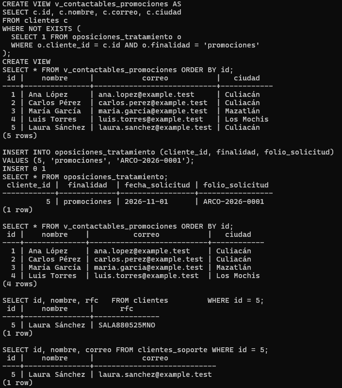

# Evidencia 05 — Análisis de una finalidad secundaria

| | |
|---|---|
| Estudiante | Cristopher Enrique Sánchez Castañeda · Matrícula 20434863 · Grupo 403 |
| Actividad | 11. Actividad 5 — Analizar una finalidad secundaria |
| Fecha | 2026-10-31 |
| Script relacionado | `sql/02-finalidad.sql` (segunda parte: oposición y vista para promociones) |

## Objetivo

Analizar la propuesta de usar los datos de clientes para "enviar promociones personalizadas basadas en la edad, ciudad y comportamiento de compra". Separar lo que decide la organización (privacidad, jurídico, dirección) de lo que puede preparar el DBA para que, si el tratamiento se aprueba, marketing reciba solo lo necesario.

## Procedimiento

1. Comparar la nueva finalidad con aquellas para las que se obtuvieron los datos (evidencia 01).
2. Revisar qué datos pide la propuesta y si existen en la base.
3. Responder las cinco preguntas del enunciado.
4. Preparar el mecanismo técnico que limitaría lo entregado y respetaría las oposiciones (`v_contactables_promociones` y `oposiciones_tratamiento`), sin otorgarlo a ningún rol, y comprobar que funciona.

## Resultado

### Pregunta 1 — ¿El hecho de que la organización ya tenga los datos significa automáticamente que puede usarlos para cualquier finalidad?

No. Los datos se pidieron para atender y facturar. Mandar promociones es otra finalidad, y según el principio de limitación de finalidad cada uso tiene que estar definido y ser compatible con lo que se le dijo al titular. Que el dato esté en la base es un hecho técnico; no es un permiso.

Si promociones es compatible, si aparecía en el aviso de privacidad y si el titular se puede negar, lo responde privacidad o jurídico. El DBA no.

### Pregunta 2 — ¿Qué preguntas debería hacer la organización antes de implementar este tratamiento?

| Pregunta | Quién la responde |
|---|---|
| ¿El aviso de privacidad mencionaba esta finalidad? ¿Es secundaria? | Privacidad / jurídico |
| ¿Cuál es la base jurídica? ¿Hace falta consentimiento o basta con dar la opción de negarse? | Jurídico |
| ¿Cómo se niega u opone el titular y cómo queda registrado? | Privacidad (procedimiento) y DBA (registro técnico) |
| ¿Cuáles son los datos mínimos? ¿Hay que identificar a la persona o bastan segmentos? | Marketing con privacidad |
| El "comportamiento de compra", ¿de dónde sale? La tabla `clientes` no lo tiene. ¿Sería una recolección nueva? | Propietario de datos / privacidad |
| ¿Habrá perfilamiento o decisiones automáticas sobre las personas? | Privacidad / jurídico |
| ¿Entra un tercero, como una plataforma de correo masivo? ¿Es encargado o hay transferencia? | Jurídico (contrato) y DBA/TI (cómo se entrega) |
| ¿Cuánto tiempo se guardan las listas y segmentos de cada campaña? | Propietario de datos |
| ¿Quién en marketing tendrá acceso y con qué controles? | Lo decide el propietario de datos y lo implementa el DBA |

### Pregunta 3 — ¿Qué datos serían realmente necesarios?

| Dato | ¿Hace falta para promociones? | Motivo |
|---|---|---|
| `correo` | Sí | Es por donde se envía. |
| `nombre` | Opcional | Solo para personalizar el saludo. |
| `ciudad` | Sí, para segmentar | Promociones por zona. |
| `edad` | Solo como rango | Para segmentar no hace falta la edad exacta. |
| `telefono` | No | La campaña es por correo. Usar el teléfono (llamadas, SMS) sería otra finalidad. |
| `rfc` | No | No tiene nada que ver con promociones. |
| `codigo_postal` completo | No | Con la ciudad o la región basta. |
| Comportamiento de compra | No existe en la base | Antes hay que decidir si se puede recolectar y para qué. No se jala de otro sistema sin esa decisión. |

### Pregunta 4 — ¿Necesitaría el área de marketing acceso directo a `clientes`?

No. Con acceso a `clientes`, marketing vería RFC, teléfono, edad exacta y código postal de todos, incluidos los que se opusieron. Lo que debe recibir es una vista, o una exportación controlada, con los campos aprobados y sin las personas que se negaron.

### Pregunta 5 — ¿Qué controles técnicos podrían limitar la información entregada?

- Una vista con las columnas mínimas (correo, nombre, ciudad, rango de edad) en lugar de la tabla.
- Un registro de oposiciones por finalidad que la vista use como filtro. Quien se opone sale de promociones sin que se borre su registro.
- Un rol `marketing` con `SELECT` únicamente sobre esa vista y sin acceso a `clientes`, igual que se hizo con `analista` en la Actividad 4.
- Generalizar: rangos de edad y ciudad en vez de código postal.
- Si la lista sale hacia una plataforma externa, que vaya en un archivo con esos campos y nada más, registrado, cifrado y con fecha para borrarse.
- Un periodo de retención para las listas de campaña, que se borren al terminar.
- Auditoría de quién consulta o exporta la vista (se ve en la Unidad III).

### Comprobación técnica del control

El mecanismo está en `sql/02-finalidad.sql`. La vista no se otorgó a ningún rol porque la finalidad todavía no está aprobada.

```sql
CREATE TABLE oposiciones_tratamiento (
  cliente_id      BIGINT      NOT NULL REFERENCES clientes(id),
  finalidad       VARCHAR(40) NOT NULL CHECK (finalidad IN ('promociones')),
  fecha_solicitud DATE        NOT NULL DEFAULT CURRENT_DATE,
  folio_solicitud VARCHAR(20) NOT NULL,
  PRIMARY KEY (cliente_id, finalidad)
);

CREATE VIEW v_contactables_promociones AS
SELECT c.id, c.nombre, c.correo, c.ciudad
FROM clientes c
WHERE NOT EXISTS (SELECT 1 FROM oposiciones_tratamiento o
                  WHERE o.cliente_id = c.id AND o.finalidad = 'promociones');
```

Antes de cualquier oposición la vista devuelve 5 clientes. Luego Laura Sánchez (id 5) se opone a las promociones:

```
INSERT INTO oposiciones_tratamiento (cliente_id, finalidad, folio_solicitud)
VALUES (5, 'promociones', 'ARCO-2026-0001');
INSERT 0 1

SELECT * FROM v_contactables_promociones ORDER BY id;
 id |    nombre    |          correo           |   ciudad
----+--------------+---------------------------+------------
  1 | Ana López    | ana.lopez@example.test    | Culiacán
  2 | Carlos Pérez | carlos.perez@example.test | Culiacán
  3 | María García | maria.garcia@example.test | Mazatlán
  4 | Luis Torres  | luis.torres@example.test  | Los Mochis
(4 rows)
```

Para las finalidades principales sigue siendo cliente:

```
SELECT id, nombre, rfc FROM clientes WHERE id = 5;            -- facturación
 id |    nombre     |      rfc
----+---------------+---------------
  5 | Laura Sánchez | SALA880525MNO

SELECT id, nombre, correo FROM clientes_soporte WHERE id = 5;  -- atención
 id |    nombre     |           correo
----+---------------+----------------------------
  5 | Laura Sánchez | laura.sanchez@example.test
```

### Capturas de ejecución

Ejecución de `sql/02-finalidad.sql` en el equipo del estudiante (contenedor `lab-postgres`). La vista empieza con 5 clientes, se registra la oposición con folio `ARCO-2026-0001`, la vista baja a 4, y Laura sigue apareciendo para facturación y atención.



## Análisis

La propuesta junta tres cosas distintas: usar datos que ya existen (edad, ciudad) para algo nuevo, recolectar uno que no existe (comportamiento de compra) y, probablemente, mandar datos a un tercero (la plataforma de envío). Cada una pide una decisión diferente, y ninguna le corresponde al DBA.

El RFC y el teléfono no sirven para promocionar nada. Si marketing recibiera la tabla completa, tendría datos que no usa y que no debería tener.

La prueba deja ver que separar finalidades no obliga a borrar ni a duplicar datos. Con un registro de oposiciones y una vista, el mismo cliente sigue disponible para facturación y atención, pero no para promociones.

La vista quedó creada y sin permisos, y eso refleja cómo se reparten las responsabilidades: el DBA deja lista la parte técnica; privacidad y jurídico deciden si se usa.

Tiene un límite. La vista protege a quien consulta la base, pero si la lista se exporta a una plataforma externa, una oposición registrada después ya no llega a esa copia. Por eso la exportación se tiene que generar de nuevo en cada campaña y no reutilizarse.

## Conclusión

La propuesta de promociones tiene que pasar primero por privacidad y jurídico. Si la aprueban, marketing debería recibir correo, nombre, ciudad y rango de edad a través de una vista que saque sola a quien se opuso, y nunca acceso directo a `clientes`. El DBA no decide si la finalidad procede; se encarga de que, si procede, el tratamiento se quede en lo necesario.
