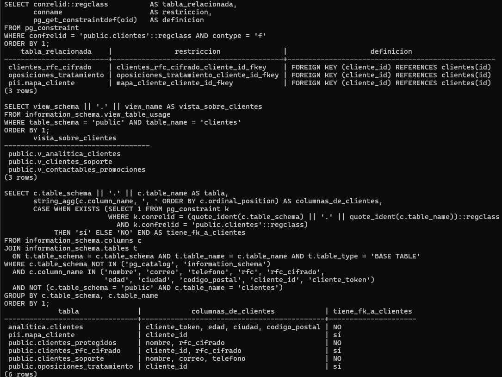

# Evidencia 08 — Derecho de cancelación y ciclo de vida

| | |
|---|---|
| Estudiante | Cristopher Enrique Sánchez Castañeda · Matrícula 20434863 · Grupo 403 |
| Actividad | 14. Actividad 8 — Derecho de cancelación y ciclo de vida |
| Fecha | 2026-10-31 |
| Script | `sql/03-control-acceso.sql` (última parte) |

## Objetivo

Antes de atender una cancelación que el área responsable ya autorizó, ubicar todos los lugares donde hay información del titular. La idea es mostrar que un `DELETE` en la tabla principal no saca a la persona de la organización.

## Procedimiento

No se ejecutó ningún `DELETE`, como pide el enunciado. En su lugar se consultó el catálogo de PostgreSQL para encontrar tres cosas dentro de la base:

- tablas relacionadas por llave foránea (`pg_constraint`);
- vistas que leen de `clientes` (`information_schema.view_table_usage`);
- tablas con columnas de datos de clientes aunque no tengan llave foránea, que en la práctica son copias (`information_schema.columns`).

Con eso se armó el mapa, y se completó con lo que está fuera de la base: lo que existe en este laboratorio (respaldos, registros, volumen de Docker, repositorio) y lo que habría en producción (réplicas, exportaciones, sistemas externos). El ejemplo es Ana López (id 1), a quien la Actividad 6 ya encontró en varias tablas.

## Resultado

### Dentro de la base: tablas relacionadas por llave foránea

```
    tabla_relacionada    |               restriccion               |                    definicion
-------------------------+-----------------------------------------+--------------------------------------------------
 clientes_rfc_cifrado    | clientes_rfc_cifrado_cliente_id_fkey    | FOREIGN KEY (cliente_id) REFERENCES clientes(id)
 oposiciones_tratamiento | oposiciones_tratamiento_cliente_id_fkey | FOREIGN KEY (cliente_id) REFERENCES clientes(id)
 pii.mapa_cliente        | mapa_cliente_cliente_id_fkey            | FOREIGN KEY (cliente_id) REFERENCES clientes(id)
(3 rows)
```

Ninguna define `ON DELETE`, así que aplica el comportamiento por defecto (`NO ACTION`). Un `DELETE FROM clientes WHERE id = 1` sería rechazado mientras existan esas filas, y eso obliga a decidir qué se hace con cada tabla relacionada.

### Dentro de la base: vistas que leen de `clientes`

```
       vista_sobre_clientes
-----------------------------------
 public.v_analitica_clientes
 public.v_clientes_soporte
 public.v_contactables_promociones
(3 rows)
```

Las vistas no guardan datos. Si se borra el registro original, el titular desaparece de ellas sin hacer nada más.

### Dentro de la base: copias (columnas de clientes con o sin llave foránea)

```
             tabla              |            columnas_de_clientes            | tiene_fk_a_clientes
--------------------------------+--------------------------------------------+---------------------
 analitica.clientes             | cliente_token, edad, ciudad, codigo_postal | NO
 pii.mapa_cliente               | cliente_id                                 | sí
 public.clientes_protegidos     | nombre, rfc_cifrado                        | NO
 public.clientes_rfc_cifrado    | cliente_id, rfc_cifrado                    | sí
 public.clientes_soporte        | nombre, correo, telefono                   | NO
 public.oposiciones_tratamiento | cliente_id                                 | sí
(6 rows)
```

Las tres que dicen NO son copias que ninguna restricción liga a `clientes`.

`clientes_soporte` se creó en este laboratorio (Actividad 2) y tiene nombre, correo y teléfono. Un `DELETE` en `clientes` no la toca, y la base no avisa.

`analitica.clientes` viene de LAB-01. Es una copia seudonimizada con edad exacta y código postal completo, y se conecta con la persona a través de `pii.mapa_cliente`. Si se borra el mapa, la fila se queda sin dueño aparente, pero sigue ahí con datos suficientes para reidentificar.

`clientes_protegidos` es una tabla de prueba de LAB-02 con nombre y RFC cifrado.

Esto es lo que la Actividad 6 encontró de Ana en cada lugar:

```
              ubicacion               | registros
--------------------------------------+-----------
 public.clientes                      |         1
 public.clientes_soporte (copia)      |         1
 public.clientes_rfc_cifrado (LAB-02) |         1
 public.oposiciones_tratamiento       |         0

           ubicacion            | registros        ← copias seudonimizadas de LAB-01
--------------------------------+-----------
 pii.mapa_cliente (LAB-01)      |         1
 analitica.clientes (vía token) |         1
```

### Mapa completo

```
clientes  (public.clientes · id 1 = Ana López)
   │
   ├── tablas relacionadas (FK, NO ACTION: bloquean el DELETE)
   │     ├── clientes_rfc_cifrado ........ RFC cifrado (LAB-02)
   │     ├── pii.mapa_cliente ............ token ↔ cliente (LAB-01)
   │     └── oposiciones_tratamiento ..... oposiciones por finalidad (LAB-03)
   │
   ├── copias sin FK (no se enteran del DELETE)
   │     ├── clientes_soporte ............ nombre, correo, teléfono
   │     ├── analitica.clientes .......... token, edad, ciudad, CP, fecha_alta
   │     └── clientes_protegidos ......... nombre, RFC cifrado
   │
   ├── vistas (no guardan datos; se actualizan solas)
   │     └── v_analitica_clientes, v_clientes_soporte, v_contactables_promociones
   │
   ├── respaldos
   │     └── pg_dump / respaldos programados: en LAB-02 (evidencia 07) un respaldo
   │         sin cifrar mostró correo y RFC en texto claro. Un respaldo de ayer
   │         contiene a Ana aunque hoy se borre.
   │
   ├── réplicas
   │     └── en producción, cada réplica (streaming, lectura, reportes) recibe el
   │         mismo DELETE, pero una réplica retrasada o desconectada lo conserva.
   │
   ├── almacenamiento del servidor
   │     ├── volumen de Docker pgdata: el DELETE marca la fila como muerta; el
   │     │   espacio se recupera con VACUUM, no al instante.
   │     ├── WAL (registro de transacciones): contiene los cambios recientes.
   │     └── log del servidor: con log_statement = all, en LAB-02 (evidencia 03)
   │         quedaron consultas completas con sus valores.
   │
   ├── reportes
   │     └── reportes de analítica ya generados (agregados: normalmente no identifican).
   │
   ├── exportaciones
   │     └── CSV/Excel enviados por correo, listas de campaña, archivos en equipos
   │         de empleados. Fuera del control de la base.
   │
   ├── copias de desarrollo y pruebas
   │     └── si se restauró producción en desarrollo, Ana está ahí también.
   │         En este laboratorio, los INSERT del LAB-01 están en el repositorio Git:
   │         son datos ficticios, pero con datos reales sería otra copia en GitHub.
   │
   └── sistemas externos
         ├── facturación electrónica (comprobantes fiscales emitidos con su RFC)
         ├── plataforma de correo / CRM (si se exportó la lista)
         └── encargados que procesan datos por cuenta de la empresa
```

### Respuesta

¿Por qué eliminar un registro de una tabla no necesariamente significa que toda la información relacionada con esa persona haya desaparecido de la organización?

Porque la tabla principal es apenas uno de los lugares donde está el dato. En esta misma base, Ana López aparece en otras cuatro tablas: dos ligadas por llave foránea (`clientes_rfc_cifrado` y `pii.mapa_cliente`) y dos copias sin relación (`clientes_soporte` y `analitica.clientes`). Las copias no se enteran de un `DELETE` en `clientes`.

Fuera de la base, el dato sigue en respaldos, en el WAL y los logs, en réplicas, en archivos exportados, en ambientes de desarrollo y en sistemas de terceros. Y aun dentro de PostgreSQL, un `DELETE` no borra la fila en ese momento: la marca como muerta, y el espacio se libera después con `VACUUM`.

### Capturas de ejecución

Ejecución de `sql/03-control-acceso.sql` en el equipo del estudiante (contenedor `lab-postgres`). Arriba están las tres tablas con llave foránea hacia `clientes`, en medio las tres vistas y abajo las seis tablas con datos de clientes, tres de ellas copias sin relación.



## Análisis

Las llaves foráneas tienen dos caras. Por un lado, la base no deja borrar al cliente hasta que se decida qué pasa con su RFC cifrado, su token y sus oposiciones. Por otro, alguien podría "arreglar" el error poniendo `ON DELETE CASCADE` sin pensarlo, y algunas de esas filas quizá se tenían que conservar, como la información fiscal con plazo legal.

El riesgo mayor está en las copias sin relación. `clientes_soporte` nació en este laboratorio para minimizar datos, y aun así el `DELETE` no la alcanza. Quitar columnas no resuelve el ciclo de vida: cada copia nueva es un lugar más que mantener.

`analitica.clientes` muestra que seudonimizar no es anonimizar. No tiene nombre, pero con el mapa se llega a Ana. Si se borra el mapa y se deja la fila, quedan su edad exacta, su ciudad y su código postal, y con tan pocos registros eso basta para identificarla.

Los respaldos no se editan fila por fila. Lo normal es dejar que expiren según su propia retención y, si alguno se restaura, volver a aplicar las cancelaciones pendientes. Para eso hay que llevar registro de las cancelaciones atendidas.

Tampoco todo debe borrarse. Puede haber información que se tenga que guardar por ley (la fiscal, por ejemplo), bloqueada y sin usarse para nada más. Qué se conserva y qué se suprime lo deciden jurídico y privacidad. El DBA les da este mapa para que decidan con todo a la vista.

## Conclusión

Cancelar no es correr un `DELETE`; es un proceso. Antes de borrar hay que ubicar todos los lugares donde está el dato. Aquí la consulta al catálogo encontró seis tablas además de `clientes`, y tres eran copias que el borrado no alcanzaría. Con ese mapa, las áreas responsables deciden qué se elimina, qué se guarda bloqueado y qué se hace con respaldos y sistemas externos, y el DBA lo ejecuta y lo documenta.
